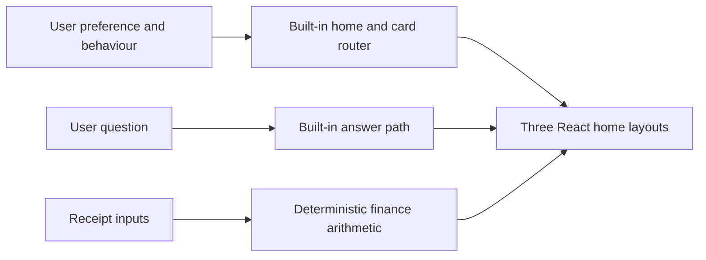
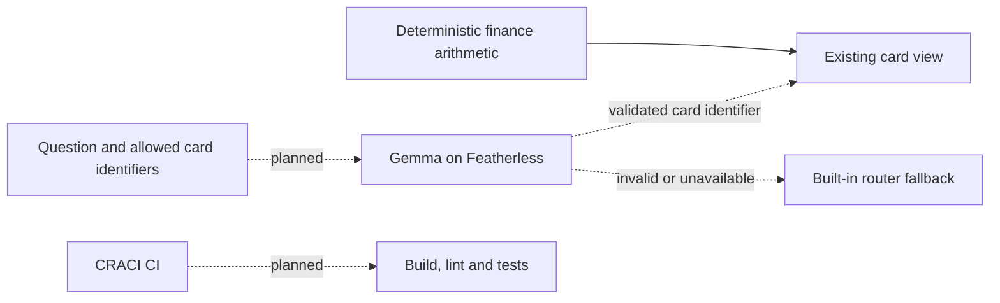

# Kori

A personal finance workspace that adapts its home screen to how someone wants to manage money, while keeping the arithmetic visible.

[Open Kori](https://kori-4ol.pages.dev) · [Current source branch](https://github.com/13shreyansh/kori/tree/claude/rebuild) · [Evaluation notes](eval/README.md)

Built by Shreyansh, team The CS Guy, for Junction 2026's S-Pankki Personal Economic Trainer challenge.

## Use the workspace

Enter through the live page's account instructions. Choose the home that suits your behaviour, review the money cards and ask a question. Kori has three home layouts with fixed blocks. Its behaviour-age explanation is visible and the user can override the choice.

Receipt calculations use deterministic arithmetic. Product actions are prototypes, not real transfers, bookings or bank-account instructions. The interface should help someone inspect a choice without hiding how the numbers were calculated.

## How the current build works



React, TypeScript and Vite provide the interface. The current public demo runs on Cloudflare Pages. Local and session state hold the prototype experience. The `claude/rebuild` branch is the current source; `main` and the older Vercel deployment describe an earlier build.

The code includes a Gemini route handler in `app/api/route.js`. The latest live route check returned the fallback path. Kori therefore does not claim active Gemini access or enter the Gemini prize on that basis. Its built-in router still answers supported questions.

## Sponsor use and planned model role

| Service | Status and concrete role |
| --- | --- |
| Codex | Used during development, debugging and verification. |
| CRACI | **Planned, not implemented.** Run the existing application checks on CRACI CI. |
| Gemma through Featherless | **Planned, not implemented.** Select the most relevant existing card for a question and return a validated card identifier. |
| Gemini | Handler present, but the latest live check used fallback. Active provider access is unverified. |

Gemma will route a question to an existing card. It will not calculate balances, invent account data or authorize money movement. Arithmetic and prototype-action boundaries stay in deterministic code. Draft sponsor registration records the planned Gemma work, not a successful model call.

## Run locally

Use the current branch and work from `app/`.

```bash
git switch claude/rebuild
cd app
npm ci
npm run generate
npm run dev
```

The built-in paths can be inspected without a provider key. The published Cloudflare Functions adapter at `app/functions/api/route.js` wraps the provider handler. A real provider response still needs securely configured runtime secrets; Vite alone does not prove that the hosted API route works. Never put a provider key in client-side code or commit a demo account credential.

Cloudflare is the current deployment target. A Git push to this repository is not proof of a new Cloudflare release. Verify the deployed page and its route separately after any future release.

## Validate

```bash
npm run build
npm run lint
npm test
BASE_URL=https://kori-4ol.pages.dev npm run test:e2e
```

Run these commands from `app/`. Browser acceptance should inspect both a wide screen and a phone-sized screen, wait for loaded cards and use isolated test state. A build passing does not establish that a provider call succeeded; inspect the route's fallback result explicitly.

The earlier persona experiment reported 185/185 agreement. This is a measured historical result for the former persona system, not a validation of today's home selector, financial outcomes or the planned Gemma router. Current routing needs its own frozen evaluation.

## Planned architecture and acceptance



After implementation approval, a server-side Featherless call must run a named Gemma model, return only an allowed card identifier and fall back safely on malformed output or provider failure. Evaluate it against a frozen set of questions with expected cards, record routing accuracy and latency, and confirm it never alters receipt arithmetic. CRACI needs a real successful workflow with `runs-on: craci`. No Featherless call, Gemma score or CRACI run is claimed today.

## Code guide

`app/src/banking/finance.ts` owns finance calculations. `app/src/banking/router.ts` owns the built-in routing logic. `app/api/route.js` contains the provider handler. `eval/` retains historical experiment protocols and results. See [DECISIONS.md](DECISIONS.md) for recorded trade-offs; older scripts and walkthroughs may target the former Vercel build.
