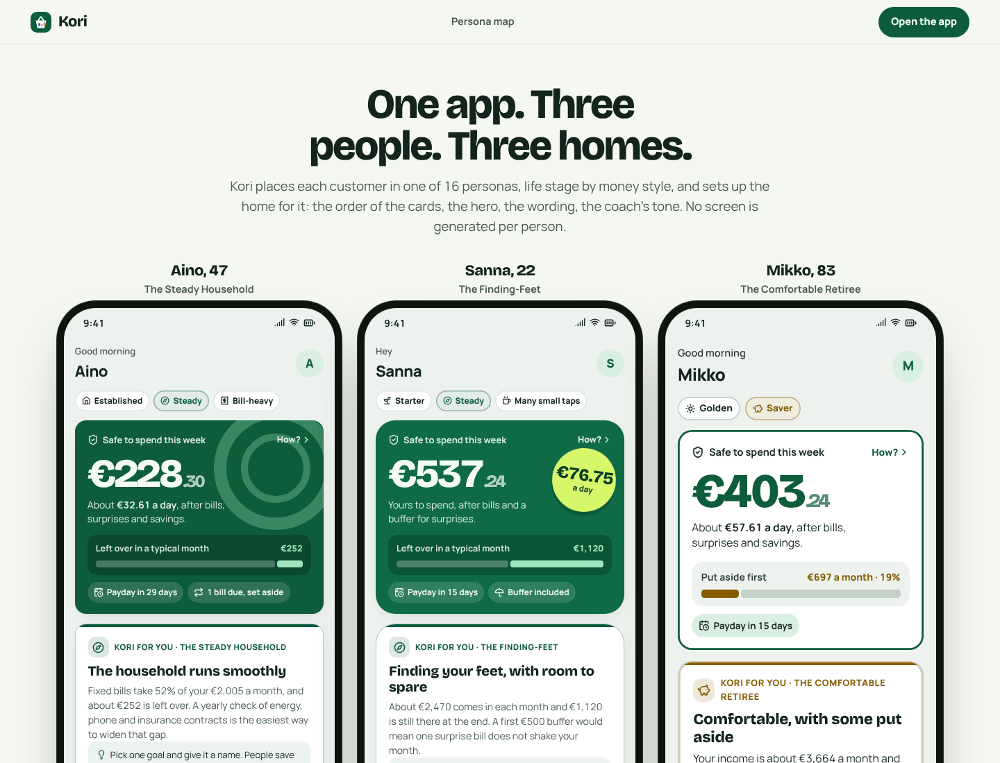

# Kori: a money coach for S-mobiili

Junction 2026 · S-Pankki challenge "Personal Economic Trainer".

Kori lives inside the S-mobiili banking app and helps people understand their money through
S-Pankki's three baskets: **fixed bills** (mandatory and regular), **surprise costs** (mandatory but
irregular) and **everyday spending** (the small taps that slip through your fingers).



## What it does
- **Safe to spend this week:** income, minus bills that are coming, a monthly share of surprise costs and savings, spread over the days to payday. Tap it to see the whole calculation.
- **A coach you can ask anything** in English or Finnish. Every number in an answer is a tappable receipt that shows the formula and the payments behind it.
- **Behaviour segments.** Kori puts each customer into one of 8 segments from what they do with money, not just their age: salary passed on to another bank, light users, retirees, starters, tight months, many small taps, savers and heavy fixed bills. Each segment has its own home card, coach tone, questions, what-if sliders and nudges. Nothing is generated per person, so it scales to 1.7 million weekly users.
- **Guess first:** guess what you spent on cafés before you see it. Most people guess low.
- **What-if lab:** sliders picked for your segment, showing the effect a year out and five years out.

## How the AI is used
A deterministic engine (`app/src/engine`) computes every number on the device. The language model (Gemini, optional)
only writes the answer, through function calls that return **totals, never raw transactions**. A grounding guard
rejects any answer whose euro amounts or percentages do not match a tool result, and falls back to the on-device coach,
so the demo works with no API key at all.

## Evaluation
The evals live in `eval/` and are tied to the challenge rubric:
- An **independent Python answer key** (`eval/make_items.py`, `eval/segment_key.py`) re-derives every expected number from the raw
  data, using a written spec (`eval/SPEC.md`, `eval/SEGMENTS_SPEC.md`). It shares no code with the app.
- **Dev and held-out splits** are separated by a hash of the customer id, and the two splits use different wording. The held-out split is only
  run at checkpoints, and every run is logged in `eval/HELDOUT_LEDGER.md`.
- **Planted-truth checks** for segments, and hand spot checks of the home cards.
- First run on S-Pankki's data, held-out customers: coach 99.5% macro score, segment assignment 100% in agreement with the key.

## Run it
```
cd app && npm install && npm run dev
```
Set `GEMINI_API_KEY` to turn on the Gemini coach, which works through `api/gemini.js` on Vercel or the dev middleware locally.
The processed data comes from S-Pankki's challenge dataset (see `data/prepare_data.py`). Full output: github.com/13shreyansh/kori-spankki-data.

## Licence
MIT
