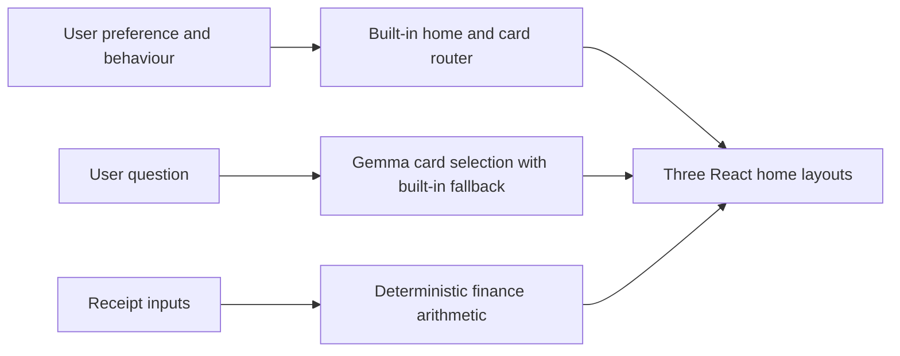
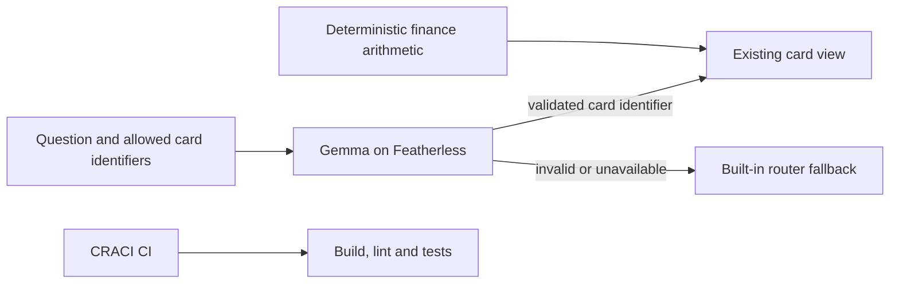

# Kori

A personal finance workspace that adapts its home screen to how someone wants to manage money, while keeping the arithmetic visible.

[Open Kori](https://kori-4ol.pages.dev) · [Current source branch](https://github.com/13shreyansh/kori/tree/claude/rebuild) · [Evaluation notes](eval/README.md)

Built by Shreyansh, team The CS Guy, for Junction 2026's S-Pankki Personal Economic Trainer challenge.

## Use the workspace

Enter through the live page's account instructions. Choose the home that suits your behaviour, review the money cards and ask a question. Kori has three home layouts with fixed blocks. Its behaviour-age explanation is visible and the user can override the choice.

Receipt calculations use deterministic arithmetic. Product actions are prototypes, not real transfers, bookings or bank-account instructions. The interface should help someone inspect a choice without hiding how the numbers were calculated.

## How the current build works



React, TypeScript and Vite provide the interface. The current public demo runs on Cloudflare Pages. Local and session state hold the prototype experience. The `claude/rebuild` branch is the current source; `main` and the older Vercel deployment describe an earlier build.

The server-side route in `app/api/route.js` asks `google/gemma-3-4b-it` on Featherless to choose an existing card. It validates the identifier and copies only numbers explicitly present in the question. Only the question enters the model request, never account balances or transaction histories. Invalid output, an unavailable provider or a request exceeding nine seconds returns the built-in routing path. The older Gemini handler remains available when no Featherless key is configured; active Gemini access is not claimed.

## Sponsor use

| Service | Status and concrete role |
| --- | --- |
| Codex | Used during development, debugging and verification. |
| CRACI | Runs the application build, lint, 25 finance/date tests and seven provider-contract tests on `runs-on: craci`. [Verified runner execution](https://github.com/13shreyansh/kori/actions/runs/43686120111). |
| Gemma through Featherless | Implemented server-side selection of receipt, plan timeline, payday runway, upcoming bills, spending baskets or unsupported. The real six-question verification selected all six expected cards. |
| Gemini | Handler present, but the latest live check used fallback. Active provider access is unverified. |

Gemma routes a question to an existing card. It cannot calculate balances or authorize money movement. Arithmetic and prototype-action boundaries stay in deterministic code. A measured six-question compatibility check on 15 November selected 6/6 expected cards, with response times of 3,036–4,581 ms. The initial deployed five-second budget produced 5/6 development responses and 4/6 independent held-out responses, counting timeouts as misses. The final server budget is nine seconds, with a 10.5-second client bound. These small sets are not a population accuracy estimate. Larger Gemma models timed out more often in the initial check, so this task uses the smaller four-billion-parameter model.

## Run locally

Use the current branch and work from `app/`.

```bash
git switch claude/rebuild
cd app
npm ci
npm run generate
npm run dev
```

The built-in paths can be inspected without a provider key. The published Cloudflare Functions adapter at `app/functions/api/route.js` wraps the provider handler. Configure `FEATHERLESS_API_KEY` as an encrypted Pages secret for production and preview. `FEATHERLESS_MODEL` optionally overrides the default model. Vite alone does not run the hosted API route. Never put a provider key in client-side code or commit a demo account credential.

Cloudflare is the current deployment target. A Git push to this repository is not proof of a new Cloudflare release. Verify the deployed page and its route separately after any future release.

## Validate

```bash
npm run build
npm run lint
npm test
node --test scripts/gemma-router.test.mjs
BASE_URL=https://kori-4ol.pages.dev npm run test:e2e
```

Run these commands from `app/`. Browser acceptance should inspect both a wide screen and a phone-sized screen, wait for loaded cards and use isolated test state. A build passing does not establish that a provider call succeeded; inspect the route's fallback result explicitly.

The earlier persona experiment reported 185/185 agreement. This is a measured historical result for the former persona system, not a validation of today's home selector, financial outcomes or the current Gemma router. The current six-question result is reported separately above.

## Model and verification boundaries



Provider-contract tests cover failure fallback, malformed JSON, unknown cards, request isolation and rejection of invented numeric substrings or signed amounts. Finance calculations remain covered by the existing tests. Deployment acceptance runs the existing customer flows at desktop and phone widths, plus live API requests that must explicitly report `provider: featherless` and `fallback: false`. Real provider calls and the completed CRACI job establish implementation evidence; prize eligibility remains the organizer’s decision.

## Code guide

`app/src/banking/finance.ts` owns finance calculations. `app/src/banking/router.ts` owns the built-in routing logic. `app/api/route.js` contains the provider handler. `eval/` retains historical experiment protocols and results. See [DECISIONS.md](DECISIONS.md) for recorded trade-offs; older scripts and walkthroughs may target the former Vercel build.
